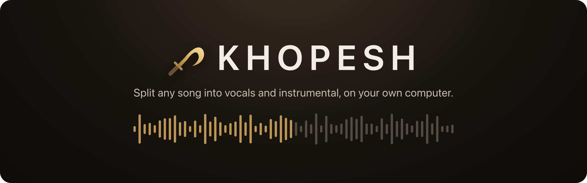
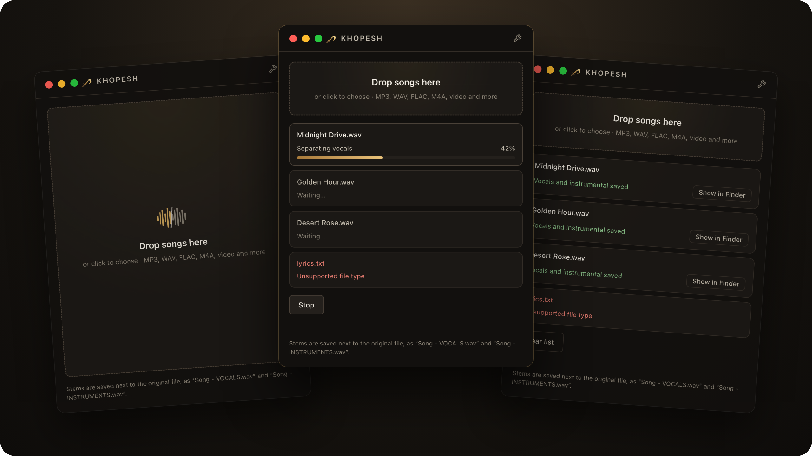
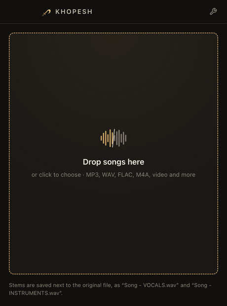
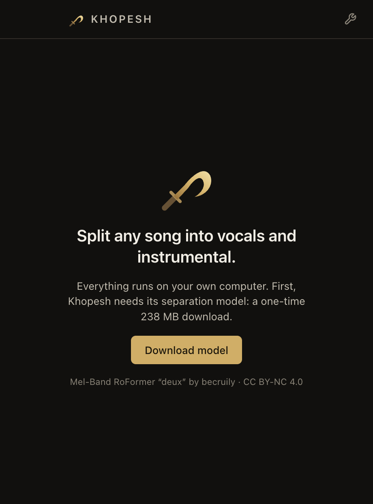
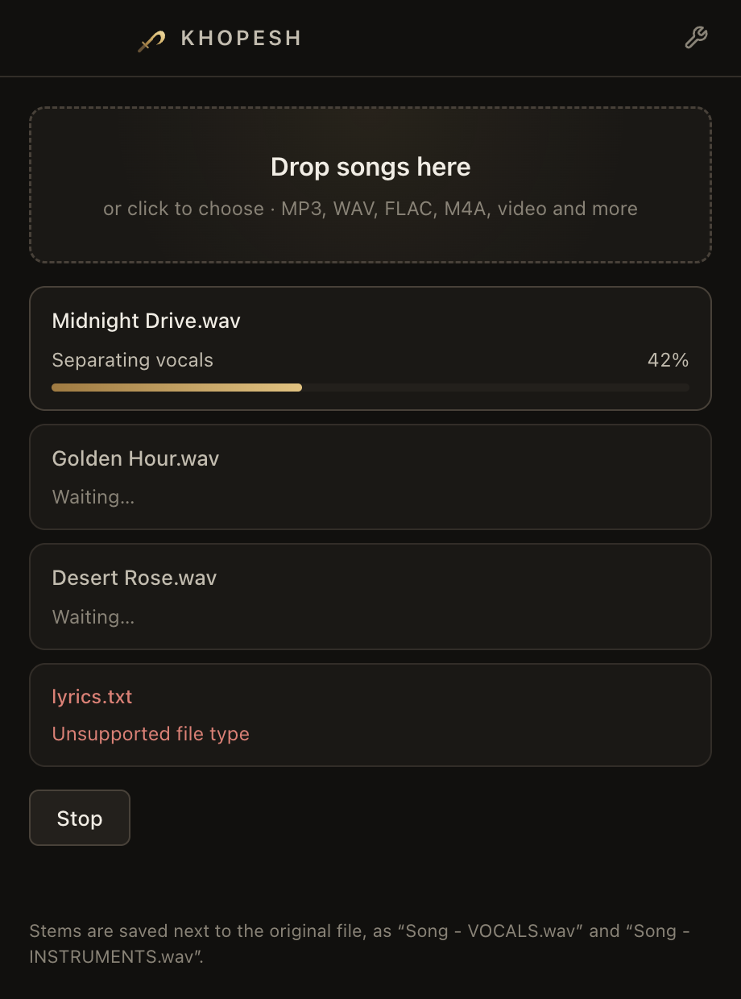
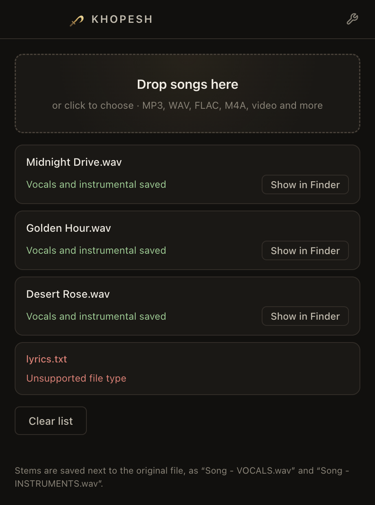
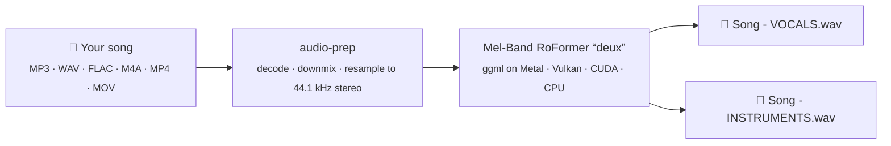
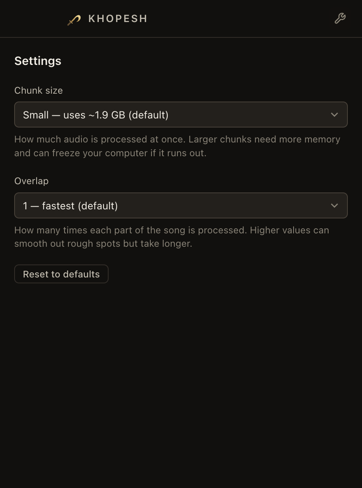

<p align="center">
  
</p>

<p align="center">
  <a href="../../releases/latest"></a>
  <a href="../../releases/latest"></a>
  
  <a href="LICENSE"></a>
</p>

<p align="center">
  <b>Drop in a song. Get the vocals and the instrumental as two clean WAV files.</b><br>
  No uploads, no account, no subscription. Everything happens on your computer.
</p>

<p align="center">
  
</p>

---

## Why Khopesh

- **🔒 Private by design.** Your audio never leaves your machine. After a one-time model download, Khopesh works fully offline.
- **🎚️ Studio-grade separation.** It runs becruily's *Mel-Band RoFormer "deux"*, one of the best open vocal-separation models, on your graphics card.
- **⚡ Fast.** A 3½-minute song splits in about **45 seconds** on an Apple M5 MacBook Pro.
- **🎞️ Takes almost anything.** MP3, WAV, FLAC, M4A/AAC, AIFF, and the audio track of video files (MP4, MOV).
- **📚 Batch friendly.** Drop a whole album. Khopesh works through the queue one song at a time.
- **🛟 Never overwrites.** Stems are saved next to the original. Split the same song again and you get `Song (2) - …` instead of losing your first take.
- **🪶 Gentle on your computer.** Memory-friendly defaults keep the rest of your system usable while it works.

## See it work

<p align="center">
  
</p>

## Download

Grab the latest build from the **[Releases page](../../releases/latest)**.

| Your computer | Download | Notes |
| --- | --- | --- |
| **Mac** with Apple Silicon (M1 or newer), macOS 13+ | `…mac-arm64.zip` | Signed and notarized. Unzip and drag **Khopesh** to Applications. |
| **Windows** 10 or 11, 64-bit | `…win-x64.zip` | Uses any modern graphics card through Vulkan, falls back to the CPU. |
| **Windows** with an NVIDIA card and the CUDA 12 toolkit | `…win-x64-nvidia.zip` | Adds the CUDA engine. Without the CUDA 12 runtime installed it quietly uses Vulkan instead. |

> [!NOTE]
> **Windows:** the app isn't code-signed yet, so SmartScreen may say *"Windows protected your PC."* Click **More info → Run anyway**.
> Khopesh also needs the [Microsoft Visual C++ Redistributable (x64)](https://aka.ms/vs/17/release/vc_redist.x64.exe). Most PCs already have it, and Khopesh tells you if yours doesn't.

## How to use it

<table>
  <tr>
    <td width="33%" align="center"></td>
    <td width="33%" align="center"></td>
    <td width="33%" align="center"></td>
  </tr>
  <tr>
    <td align="center"><b>1. Download the model</b><br><sub>Once, 238 MB. Checked with SHA-256.</sub></td>
    <td align="center"><b>2. Drop your songs</b><br><sub>Or click to choose. Several at once is fine.</sub></td>
    <td align="center"><b>3. Grab your stems</b><br><sub>Saved next to each song.</sub></td>
  </tr>
</table>

For every song you get two files in the same folder:

```
Midnight Drive.mp3
Midnight Drive - VOCALS.wav        ← just the voice
Midnight Drive - INSTRUMENTS.wav   ← everything except the voice
```

## How it works



Khopesh is a small [Electron](https://www.electronjs.org/) app wrapped around two native command-line tools:

1. **`audio-prep`** (C++, in [`native/audio-prep`](native/audio-prep)) turns whatever you drop in into the exact format the model expects.
   [miniaudio](https://github.com/mackron/miniaudio) handles WAV, MP3 and FLAC. Everything else goes through your operating system's own decoders
   (AVFoundation on macOS, Media Foundation on Windows), so there's no ffmpeg to install. Resampling uses [r8brain](https://github.com/avaneev/r8brain-free-src).
2. **`bs_roformer-cli`** from [BSRoformer.cpp](https://github.com/chenmozhijin/BSRoformer.cpp) runs the separation model with [ggml](https://github.com/ggml-org/ggml).
   On a Mac it uses the GPU through Metal, including the newer Metal tensor path. On Windows Khopesh picks the fastest engine that loads: CUDA, then Vulkan, then CPU.

The model listens to the song in chunks of a few seconds at a time. That's what keeps memory use predictable.

## Settings

Open them with the wrench in the top-right corner. The defaults are the sweet spot for most computers.

| Setting | Options | What it does |
| --- | --- | --- |
| **Chunk size** | Small *(default)*, Medium, Large | How much audio the model processes at once. Uses about **1.9 GB**, **3.8 GB** or **7.5 GB** of graphics memory. In listening tests *Small* sounded no different from the larger sizes, and on a 16 GB Mac *Large* can freeze the whole system. |
| **Overlap** | 1 *(default)* to 4 | How many times each part of the song is processed and blended. Higher values can smooth rough spots: 2 takes about twice as long, 4 about four times. |

<p align="center">
  
</p>

## Privacy

Khopesh has no telemetry, no accounts, and no analytics. The only time it touches the network is the one-time model download from Hugging Face, which is verified against a SHA-256 checksum before it's used.

## FAQ

<details>
<summary><b>Can I use the stems commercially?</b></summary>

The Khopesh app is MIT-licensed. The separation model, *Mel-Band RoFormer "deux"* by becruily, is licensed **CC BY-NC 4.0**, which only allows non-commercial use. For commercial work, check with the model's author. And of course, the song itself belongs to whoever owns it.
</details>

<details>
<summary><b>My computer felt sluggish while splitting.</b></summary>

Separation uses your graphics card hard. Keep **Chunk size** on *Small*, and close other heavy apps for long queues. Khopesh keeps your computer awake while a queue runs, so you can walk away.
</details>

<details>
<summary><b>It says “Unsupported file type.”</b></summary>

Khopesh accepts MP3, WAV, FLAC, M4A, AAC, AIF/AIFF, CAF, MP4, MOV and M4V. Convert anything else to one of those first.
</details>

<details>
<summary><b>Windows says the audio engine couldn't start.</b></summary>

Install the [Microsoft Visual C++ Redistributable (x64)](https://aka.ms/vs/17/release/vc_redist.x64.exe) and try again.
</details>

<details>
<summary><b>Intel Mac? Linux?</b></summary>

Not yet. On Macs Khopesh needs Apple Silicon. The code is cross-platform, so a Linux build mostly needs someone to package it. Pull requests welcome.
</details>

## Build it yourself

You'll need **Node.js 20+**, **Git** and **CMake 3.20+**, plus **Xcode Command Line Tools** on macOS or **Visual Studio 2022 Build Tools** on Windows.

```bash
git clone https://github.com/aalmonzer/khopesh.git
cd khopesh
npm install
npm run setup   # builds audio-prep + the separator, downloads the Windows engines
npm run dev     # opens Khopesh with hot reload
```

| Command | What it does |
| --- | --- |
| `npm run setup` | Builds or downloads the native tools into `resources/bin`. Sources and downloads are pinned and checksum-verified. |
| `npm run dev` | Runs the app in development mode. |
| `npm test` | End-to-end test of the real app: first-run download, a queue of songs, settings and cancel. Set `KHOPESH_MODEL=/path/to/becruily_deux-Q8_0.gguf` to skip the download. |
| `npm run screenshots` | Runs the same test and regenerates every README image, the demo GIF and the app icon. |
| `npm run art` | Re-renders just the icon, banner and hero image from the existing screenshots. |
| `npm run package:mac` | Builds the macOS zip. Signs with your Developer ID if one is in your keychain; notarizes when `APPLE_ID`, `APPLE_APP_SPECIFIC_PASSWORD` and `APPLE_TEAM_ID` are set. |
| `npm run package:win` | Builds both Windows zips. From a Mac, run `npm run setup -- --windows` first (needs `brew install mingw-w64`). |

Pull requests and `v*` tags run the [GitHub Actions workflow](.github/workflows/build.yml), which builds every download and keeps them as workflow artifacts.

<details>
<summary><b>Project layout</b></summary>

```
src/
  main/          Electron main process: window, queue IPC, model download, runs the tools
  preload/       The small, typed bridge the interface is allowed to use
  renderer/      React interface
  shared/        Types shared by all three
native/
  audio-prep/    C++ decoder + resampler (miniaudio, r8brain, AVFoundation, Media Foundation)
scripts/
  setup.mjs      Builds or downloads native tools
  render-art.cjs Renders the icon and README artwork
tests/
  e2e.mjs        Drives the real app with Playwright
```
</details>

## Credits

- **[becruily](https://huggingface.co/becruily/mel-band-roformer-deux)** for the *Mel-Band RoFormer "deux"* model, and **[chenmozhijin](https://github.com/chenmozhijin)** for BSRoformer.cpp and the GGUF conversions.
- **[ggml](https://github.com/ggml-org/ggml)**, **[miniaudio](https://github.com/mackron/miniaudio)** and **[r8brain](https://github.com/avaneev/r8brain-free-src)** for the heavy lifting.
- The name: a **khopesh** is the curved bronze blade of ancient Egypt. It cuts one song cleanly in two.

Full license details are in [THIRD_PARTY_NOTICES.md](THIRD_PARTY_NOTICES.md).

## License

[MIT](LICENSE) © Khopesh contributors. The separation model is downloaded separately and carries its own license, [CC BY-NC 4.0](https://creativecommons.org/licenses/by-nc/4.0/).
